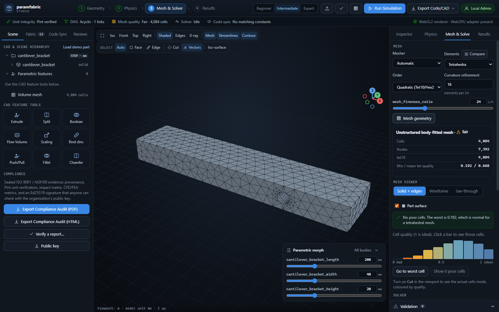

# Paramfabric Studio

A parametric CAD/CAE workbench. You keep your dimensions and engineering values in one
unit-checked parameter file, and that file drives the geometry, the mesh, the solver and any
code that uses those numbers. Change a value and everything downstream regenerates.



## What it does

- Imports STEP/IGES and edits exact B-Rep geometry (push/pull, fillet, chamfer, split, boolean)
- Meshes with gmsh: tets, hexes, prism layers, local refinement
- Runs CFD through OpenFOAM, including conjugate heat transfer
- Has its own structural solver: solids, beams, shells, modal analysis, contact
- Finds constants and formulas in Python, C/C++, Rust and OpenSCAD and keeps them in sync with the parameters
- Exports code and CAD scripts for SolidWorks, NX, Ansys, COMSOL, OpenFOAM and more
- Optional team server with reviews, audit trail and signed compliance reports

## Getting started

You need Python 3.11 or newer. Then, on Windows, just double-click `Start Paramfabric.bat`.
The first run sets everything up and takes a few minutes.

Or from a terminal on any OS:

```console
git clone https://github.com/<Semedo2002>/Paramfabric.git
cd paramfabric
python -m venv .venv
.venv\Scripts\activate            # Linux/macOS: source .venv/bin/activate
pip install -e .
paramfabric-studio --fabric examples/params.yaml
```

If you don't have a desktop window available, add `--no-window` and open the URL it prints.

First time using it? Click **Load demo part** in the Scene panel, then go through the four steps
along the top: Geometry, Physics, Mesh, Results. There's a beginner manual at
[docs/Paramfabric Academy - User Manual.pdf](<docs/Paramfabric Academy - User Manual.pdf>).
Press `Ctrl+P` to search commands and `?` to see the shortcuts.

## OpenFOAM (only for CFD)

Structural analysis works out of the box. CFD needs OpenFOAM installed separately, and it gets
detected automatically. On Windows the easiest route is WSL:

```console
wsl --install -d Ubuntu
# then inside Ubuntu, follow the openfoam.com instructions for adding their apt repository, and:
sudo apt install openfoam2506-default
```

You can also point it at a Docker image or a specific install with the `PARAMFABRIC_OPENFOAM`
variable (see the reference). I develop against OpenFOAM v2506.

## Command line

```console
paramfabric init     # create a params.yaml
paramfabric check    # validate units and dependencies
paramfabric tree     # show the dependency tree
paramfabric build    # generate the bound files
paramfabric --help   # everything else
```

## Things to know before trusting a result

- It's checked against closed-form and reference cases, listed in the
  [validation table](docs/REFERENCE.md#validation), but that doesn't replace your own
  checks on your own problem. Don't use it as the only check on anything safety critical.
- The built-in CFD solver is experimental. On external flow it disagreed with OpenFOAM by about 60%,
  so use OpenFOAM for CFD.
- Developed and tested on Windows 11 with OpenFOAM in WSL. The test suite and Docker image target
  Linux too, but macOS hasn't been tried.
- Heat transfer runs are slow at the default mesh size (around 200k cells). Start coarse.

## Running the tests

```console
pip install -e ".[dev]"
pytest
```

The full suite takes 20 to 30 minutes with OpenFOAM installed. Tests that need OpenFOAM or a live
S3 bucket are skipped if those aren't there.

## More

[docs/REFERENCE.md](docs/REFERENCE.md) has the rest: architecture, what each part can and can't do,
validation results, the REST API, the CI gate, compliance reports, deployment with Docker and Helm,
and licensing.

Bug reports are welcome. If a run fails, the error card has a **Copy details** button; paste that
into the issue.

## License

MIT, see [LICENSE](LICENSE). Bundles three.js and d3, whose licenses are in
`paramfabric/studio/static/`. gmsh (a pip dependency) and OpenFOAM (a separate install) are
GPL projects and keep their own licenses.
